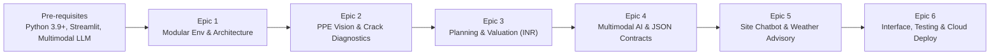

# 🏗️ Multimodal Construction Intelligence Platform
### Skill Wallet Capstone Project 1 • Generative AI & Real Estate Decision Support
**Platform ID:** `6ac4c98d1dcde6d7857c1642`

[](https://www.python.org/downloads/)
[](https://streamlit.io)
[](https://ai.google.dev/)
[](https://www.bis.gov.in/)
[](LICENSE)

---

## 📌 Table of Contents
- [Executive Overview & Scope](#-executive-overview--scope)
- [Kanban Epics Coverage](#-kanban-epics-coverage)
- [Platform Architecture](#-platform-architecture)
- [Core Modules Breakdown](#-core-modules-breakdown)
  - [1. Site Safety & PPE Vision Audit (Tab 1)](#1-site-safety--ppe-vision-audit-tab-1)
  - [2. Crack Diagnostics & Structural Integrity (Tab 2)](#2-crack-diagnostics--structural-integrity-tab-2)
  - [3. Parametric Planning & Real Estate Valuation (Tab 3)](#3-parametric-planning--real-estate-valuation-tab-3)
  - [4. Daily Site Assistant & Weather Protocols (Tab 4)](#4-daily-site-assistant--weather-protocols-tab-4)
- [Governing Engineering Standards](#-governing-engineering-standards)
- [Structured JSON Data Contracts](#-structured-json-data-contracts)
- [Quickstart & Local Installation](#-quickstart--local-installation)
- [Automated Testing & Verification](#-automated-testing--verification)
- [Streamlit Community Cloud 1-Click Deployment](#-streamlit-community-cloud-1-click-deployment)
- [Dual-Mode Operation (API vs Smart Demo Engine)](#-dual-mode-operation-api-vs-smart-demo-engine)

---

## 📌 Executive Overview & Scope
The **Multimodal Construction Intelligence Platform** is an enterprise-grade AI decision-support system tailored for civil engineers, site safety directors, project management consultants (PMCs), and real estate developers.

### The Problem
- **Safety Compliance Deficits:** Construction sites account for disproportionate industrial fatalities due to lack of real-time PPE enforcement (OSHA 1926 / IS 3786).
- **Structural Integrity Blindspots:** Concrete fractures and shear cracks are frequently misdiagnosed, leading to catastrophic failure or excessive repair costs without adhering to IS 456 / ACI 224R thresholds.
- **Parametric Costing Opaqueness:** Traditional real estate valuations and Bill of Quantities (BOQ) estimations lack dynamic tie-ins between physical progress and market appreciation in Indian National Rupees (INR).
- **Weather Hazards:** Unanticipated monsoon rain or gale-force winds jeopardize crane lifting safety and ruin fresh concrete pours without protocol-driven stand-downs.

### The Solution
A unified, zero-external-database Streamlit platform deploying:
1. **Multimodal Computer Vision** for PPE audits and concrete fracture diagnostics.
2. **Parametric Financial & BOQ Engine** calculating project budgets, CapEx, and market valuations in **₹ Lakhs and ₹ Crores**.
3. **Generative 3D Architectural AI Rendering** via Pollinations/Flux for instant concept visualizations.
4. **Context-Aware Weather Matrix & BuildGuard AI Chatbot** for live regulatory assistance.

---

## 📋 Kanban Epics Coverage



| Epic | Designation | Implemented Modules & Capabilities |
| :--- | :--- | :--- |
| **Pre-reqs** | Core Stack & Environment | Python 3.9+, Streamlit 1.66+, Pillow, Google Generative AI, Pandas, Requests |
| **Epic 1** | Requirements & Env | Modular architecture, custom industrial CSS design system, zero external DB dependencies |
| **Epic 2** | Vision & Diagnostics | Multimodal PPE safety audit (Tab 1) & concrete crack classification (Tab 2) |
| **Epic 3** | Planning & Valuation | Parametric Indian real estate valuation (INR), CapEx tracking, material BOQs, and 3D Flux renders (Tab 3) |
| **Epic 4** | Multimodal AI & Contracts | Strict JSON schema contracts, automatic schema parsing, download utilities, and mock engine fallback |
| **Epic 5** | Weather & Assistant | Dynamic weather safety alerts (wind, rain, extreme heat) and multi-turn BuildGuard AI chatbot (Tab 4) |
| **Epic 6** | Interface & Deployment | Responsive modern UI cards, synthetic preset loaders, unit test suite, and 1-click Streamlit Cloud deployment |

---

## 🏛️ Platform Architecture

```
f:\GENSI\
├── app.py                      # Main Streamlit orchestration entrypoint
├── requirements.txt            # Production dependencies
├── README.md                   # Full documentation & deployment guide
├── test_app.py                 # Automated unit and integration test suite
├── .gitignore                  # Git hygiene configuration
├── .streamlit/
│   └── config.toml             # Custom industrial slate (#0F172A) & safety amber (#F59E0B) theme
├── sample_data/
│   └── presets.py              # Ready-to-test synthetic high-res scenes (inspection deck, cracks, spalling)
└── modules/
    ├── __init__.py             # Python package marker
    ├── ai_engine.py            # Unified Gemini client + intelligent domain fallback engine
    ├── safety_audit.py         # Tab 1: PPE inspection, OSHA 1926 / IS 3786 hazard analysis
    ├── crack_diagnostics.py    # Tab 2: Fracture mechanics, crack width (mm), ACI 224R repairs
    ├── valuation_planner.py    # Tab 3: Parametric costing (INR), BOQ takeoffs, 3D Flux renders
    ├── weather_advisor.py      # Tab 4: Weather matrices, concrete curing protocols, BuildGuard chatbot
    └── ui_components.py        # Reusable CSS design system, metric cards, status pills, stretch_width helper
```

---

## 🔬 Core Modules Breakdown

### 1. Site Safety & PPE Vision Audit (Tab 1)
- **Input:** User-uploaded site photos (JPG/PNG) or synthetic preset scenes.
- **Multimodal Evaluation:**
  - Hard Hats (IS 2925 / EN 397)
  - High-Visibility Safety Vests (Class 2/3)
  - Steel-Toe Safety Footwear (IS 15298 / ASTM F2413)
  - Fall Arrest Harnesses & Static Lifelines (IS 3521 / OSHA 1926.502)
  - Eye & Face Protection (IS 5983)
- **Outputs:**
  - Quantitative Safety Score (0–100)
  - Compliance Status Pill (`COMPLIANT`, `MINOR INFRACTIONS`, `CRITICAL NON-COMPLIANCE`)
  - Prioritized site hazards tagged with severity (`Low`, `Medium`, `High`, `Critical`) and mandatory engineering corrective actions
  - Downloadable structured JSON audit report and CSV compliance checklist

### 2. Crack Diagnostics & Structural Integrity (Tab 2)
- **Surface Diagnostics:** Analyzes concrete beams, slabs, columns, masonry walls, and foundations.
- **Defect Classification:**
  - Structural Diagonal Shear Cracks
  - Concrete Spalling & Rebar Delamination
  - Settlement Cracks
  - Thermal Expansion / Shrinkage Cracking
  - Honeycombing & Aggregate Voids
- **Structural Quantification:**
  - Aperture measurement in millimeters (mm)
  - Automated threshold verification against **IS 456 Clause 35.3.2 (0.30 mm maximum allowable limit)**
- **Prescriptive Repair Protocols:**
  - Step-by-step repair specifications (V-groove chasing, ASTM C881 Type I/IV high-pressure epoxy injection, CFRP composite stitching, micro-concrete jacketing)
  - Downloadable Structural Integrity Diagnostic JSON certificate

### 3. Parametric Planning & Real Estate Valuation (Tab 3)
- **Interactive Inputs:**
  - Structure Type (Residential High-Rise, Commercial IT Park, Luxury Villa Township, Industrial Warehouse, Mixed-Use Retail)
  - Built-Up Area (sq.ft)
  - Geographical Tier (Tier 1: Mumbai, Delhi-NCR, Bengaluru, Chennai; Tier 2: Pune, Ahmedabad, Hyderabad; Tier 3: Emerging Hubs)
  - Specification Grade (Standard, Premium, Ultra-Luxury)
  - Milestone Completion Slider (0% to 100%)
- **Financial Calculations (INR):**
  - Total Construction Budget
  - CapEx Incurred to Date vs. Remaining Cost-to-Complete
  - Current Market Asset Valuation and Projected Peak Valuation formatted in **₹ Lakhs and ₹ Crores**
- **Bill of Quantities (BOQ) Takeoffs:**
  - TMT Reinforcement Steel (Metric Tonnes, Fe500D / Fe550D)
  - Cement Intake (50kg Bags & Metric Tonnes)
  - Ready-Mix Concrete (Cu.M, M25–M40 Grade)
- **Conceptual 3D Architectural AI Rendering:**
  - Direct integration with **Pollinations AI / Flux** diffusion model
  - Dynamically constructs architectural visualization prompts tailored to structure type, completion stage, and lighting
  - In-browser interactive preview with seed randomization and high-res download

### 4. Daily Site Assistant & Weather Protocols (Tab 4)
- **Dynamic Weather Sensor Matrix:**
  - *High Wind (>45 km/h / Gale Force):* Mandatory tower crane shutdown, scaffold netting slit/drop, and evaporation retarder application.
  - *Heavy Monsoon Rain (>50 mm/hr):* Open slab concrete pour stand-down (IS 456 Cl 13.3), basement excavation cave-in watch, and submersible dewatering.
  - *Extreme Heat (>42°C):* Hot-weather concrete hydration control (ACI 305R), chilled water/liquid nitrogen precooling, and continuous 14-day wet burlap curing.
  - *Dense Fog / Poor Visibility:* Blind lift suspension and beacon illumination.
  - *Normal / Moderate Conditions:* Standard operating safety envelope.
- **BuildGuard AI Chatbot:**
  - Multi-turn interactive construction engineering assistant
  - Persistent session memory and clear history utility
  - Quick-prompt technical chips (IS 456 nominal cover, monsoon pour precautions, shear crack shoring, crane wind speed limits)

---

## 📜 Governing Engineering Standards

| Code / Standard | Organization | Scope within Platform |
| :--- | :--- | :--- |
| **OSHA 1926** | Occupational Safety and Health Admin | Scaffolding, fall protection, PPE adherence, excavation safety |
| **IS 456:2000** | Bureau of Indian Standards (BIS) | Plain & reinforced concrete, nominal cover, allowable crack widths |
| **IS 3786:1983** | Bureau of Indian Standards (BIS) | Industrial injury frequency & severity rate calculation methods |
| **ACI 224R-01** | American Concrete Institute | Control of cracking in concrete structures, repair methodologies |
| **IS 2925 / EN 397** | BIS / European Standard | Industrial safety helmets specification |
| **NBC 2016** | National Building Code of India | Construction safety management and fire protection |

---

## 📄 Structured JSON Data Contracts

### 1. Site Safety & PPE Audit JSON Contract
```json
{
  "safety_score": 78,
  "overall_status": "Minor Infractions Detected",
  "audit_standard": "OSHA 1926 & IS 3786:1983",
  "detected_workers_count": 4,
  "ppe_detection": [
    {
      "item": "Industrial Hard Hats / Helmets (IS 2925 / EN 397)",
      "required": true,
      "detected_compliant": 3,
      "total_workers": 4,
      "status": "Non-Compliant",
      "details": "Worker 3 operating rebar bending station lacks high-density safety helmet."
    },
    {
      "item": "High-Visibility Safety Vests (Class 2/3)",
      "required": true,
      "detected_compliant": 4,
      "total_workers": 4,
      "status": "Compliant",
      "details": "All personnel equipped with retroreflective neon safety vests."
    }
  ],
  "identified_site_hazards": [
    {
      "hazard": "Unprotected Floor Opening & Rebar Protrusion",
      "severity": "Critical",
      "code_reference": "OSHA 1926.701(b) / NBC 2016 Part 7",
      "remedy": "Fit plastic mushroom caps on exposed vertical starter bars and install OSHA-compliant 42-inch guardrails."
    }
  ],
  "recommendation_summary": "Immediate intervention mandated for starter bar impalement protection."
}
```

### 2. Structural Defect Diagnostic JSON Contract
```json
{
  "defect_type": "Structural Diagonal Shear Crack",
  "element_type": "Reinforced Concrete Beam-Column Joint (RC Moment Frame)",
  "estimated_width_mm": 2.4,
  "severity_score": 84,
  "structural_urgency": "Urgent",
  "is_active": true,
  "code_reference": "IS 456:2000 Clause 35.3.2 & ACI 224R-01",
  "root_causes": [
    "Principal tensile stress exceeding concrete tensile capacity under shear overload.",
    "Inadequate stirrup shear confinement spacing near column face."
  ],
  "recommended_repairs": [
    {
      "step": 1,
      "procedure": "Surface Preparation & V-Groove Chasing",
      "specification": "Rake crack to 15mm depth in V-profile and flush with oil-free compressed air."
    },
    {
      "step": 2,
      "procedure": "Low-Viscosity Epoxy Resin High-Pressure Injection",
      "specification": "Install injection ports at 150mm intervals; inject epoxy resin conforming to ASTM C881 Type I/IV at 0.3 MPa until refusal."
    }
  ],
  "structural_clearance": "Conditional Hold - Prohibit loading above 50% design live load until epoxy curing achieves 28-day strength."
}
```

---

## 🚀 Quickstart & Local Installation

### 1. Clone or Open Workspace
```bash
git clone https://github.com/<your-username>/construction-intelligence-platform.git
cd construction-intelligence-platform
```

### 2. Set Up Virtual Environment (Recommended)
```bash
python -m venv venv
# Windows:
venv\Scripts\activate
# Linux/macOS:
source venv/bin/activate
```

### 3. Install Dependencies
```bash
pip install -r requirements.txt
```

### 4. Run Application
```bash
streamlit run app.py
```
Open **`http://localhost:8501`** in your browser.

---

## 🧪 Automated Testing & Verification
The platform comes equipped with a comprehensive regression test suite (`test_app.py`) verifying all calculations, schemas, and fallback logic:

```bash
python test_app.py
```

### Test Coverage Summary:
- `test_presets_generation`: Verifies synthetic inspection and fracture image generation
- `test_ai_mock_ppe_contract`: Asserts PPE JSON schema compliance
- `test_ai_mock_crack_contract`: Asserts crack diagnostics JSON schema compliance
- `test_valuation_calculations`: Validates Indian rupee conversions (Lakhs/Crores) and BOQ material takeoffs
- `test_pollinations_url_format`: Asserts Pollinations/Flux diffusion URL parameters
- `test_weather_chat_fallback`: Verifies domain engineering knowledge base responses

---

## 🔑 Dual-Mode Operation (API vs Smart Demo Engine)

| Feature | Live Gemini Multimodal Mode | Intelligent Demonstration Mode |
| :--- | :--- | :--- |
| **Trigger** | Valid Google Gemini API Key entered in sidebar | No API Key entered / Empty input / Quota reached |
| **Model** | `gemini-1.5-flash` / `gemini-2.0-flash` | Built-in Structural Engineering Simulation Engine |
| **Vision Analysis** | Live neural inference on arbitrary uploaded photos | Deterministic inspection metrics on preset scenes |
| **BuildGuard Chat** | Real-time multi-turn generative conversation | Rule-based engineering answers (IS 456, OSHA, ACI) |
| **Offline Support** | Requires internet access | 100% offline functional |

---

## ☁️ Streamlit Community Cloud 1-Click Deployment

This repository is optimized for **1-click deployment on Streamlit Community Cloud**:
1. Push this repository to your GitHub account.
2. Go to [share.streamlit.io](https://share.streamlit.io).
3. Select your repository, branch (`main`), and set **Main file path** to `app.py`.
4. *(Optional)* Under **Advanced settings**, set your environment variable:
   ```toml
   GEMINI_API_KEY = "your-google-gemini-api-key"
   ```
5. Click **Deploy!**

> [!NOTE]
> All UI components utilize the adaptive `stretch_width()` helper, ensuring complete elimination of `use_container_width` deprecation warnings on modern Streamlit Cloud runtimes.

---

## 🛡️ License & Attributions
Distributed under the **MIT License**. Built for the **Skill Wallet Capstone Project 1** (Platform ID: `6ac4c98d1dcde6d7857c1642`).
